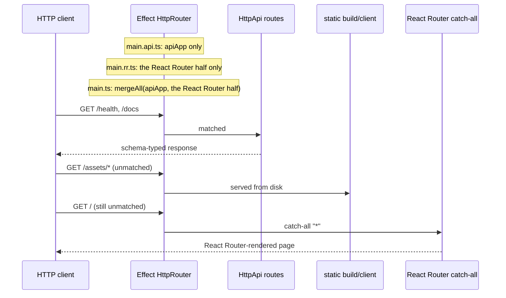

# react-router-effect-bdd

> **This repository is a proof of concept** for wiring Effect and React
> Router (Framework Mode) together. The wiring, seams, and tests are the
> deliverable; the `Greeter` feature driving them is deliberately trivial.
> It is the React Router sibling of
> [next-effect-bdd](https://github.com/tatemz/next-effect-bdd): same domain,
> same BDD features, different render side.

The question: can a React Router app run **inside a standard Effect HTTP
server** — one router, one runtime, one request context? The answer
demonstrated here is yes:

```ts
const port = yield* layerProd
  .pipe(HttpRouter.provideRequest(Greeter.layerFor(Language.Spanish)), startApp(0));
```



## What the POC proves

- **One server, two frameworks.** Effect's `HttpRouter` owns the Node HTTP
  server; React Router is a service mounted at `"*"` (through
  `@react-router/node`'s request listener, the same bridge
  `react-router-serve` uses). In development the same router defers to
  Vite's middleware stack, so on-demand compilation and HMR work through
  the Effect server unchanged.
- **One request context for both worlds.** Services from
  `HttpRouter.provideRequest` are visible to Effect handlers and — through
  an `AsyncLocalStorage` bridge into React Router's `RouterContextProvider`
  — to loaders and actions.
- **One contract, three consumers.** Handlers, OpenAPI/Swagger, and the BDD
  test client all derive from the same schema-first `HttpApi`
  (`server/api.ts`), so drift is a compile error.
- **A total mode model.** The environment's `MODE` becomes a composition
  choice at each entry point, made exhaustively over the `Mode` enum:
  a new mode without a branch is a compile error, and programmatic callers
  pick `layerProd`/`layerDev` directly.

There are three entry points: `main.rr.ts` (React Router only), `main.api.ts`
(Effect API only), and the default `main.ts`, which composes both halves on
one router with `Layer.mergeAll`.

## Layout

Dependencies point one way: `app/` and `features/` → `server/` → `domain/`.

```text
domain/greeter.ts        Greeter service and its layerFor mapping
server/config.ts         single source of truth: Mode/Language enums + schemas, AppConfig
server/api.ts            the typed Api contract: HttpApi + handlers + client type
server/apiApp.ts         standalone API app: Api routes + Swagger UI + config
server/reactRouterApp.ts standalone RR app: layerProd/layerDev (Vite middleware in dev)
server/reactRouter.ts    ReactRouter service + the catch-all + the context bridge
server/deps.ts           AppDeps + the RouterContext key loaders/actions read
server/pipeline.ts       serveApp / startApp (HttpRouter.serve over NodeHttpServer)
server/app.ts            the composed app: mergeAll(apiApp, the RR half)
app/root.tsx             root route: HTML shell, scripts, error boundary
app/routes/home.tsx      loader/action: the Effect run-promise boundaries
app/components/          viewmodels, controllers, views (shared shape with the Next POC)
features/                Gherkin features + steps + the programmatic runner
```

## Features

The [effect-bdd](https://github.com/tatemz/effect-bdd) scenarios each make
one narrow claim: the SSR'd page greets per language, the typed `/health`
API reports the same greeting (called through the generated `HttpApiClient`,
not a raw fetch), and `/docs` + `/openapi.json` are served. A Playwright
scenario proves the shared context: the page loader, the health hit, and the
reveal action all read the *same* `Incrementer` instance.

Every scenario runs against the **production lane**: the `production`
mode serves the built `build/` output, booted and released in-process per
scenario. (The app itself still ships a development lane — `layerDev` and
the `pnpm dev` scripts — but the BDD runner exercises only production.)

## Commands

```sh
pnpm install
pnpm build          # react-router build (required before start/tests)

pnpm dev            # composed app, with HMR; :rr / :api run the variants
pnpm start          # production; start:rr / start:api for the variants

pnpm test-bdd       # the whole feature, in one process: builds first
                    # (pretest-bdd), then runs the step module, which
                    # *is* the runner (effect-bdd programmatically, no CLI).
                    # Run once beforehand:
                    #   pnpm exec playwright install chromium
```

`dev` scripts carry their own env; `start` respects `PORT`, `LANGUAGE`, and
`MODE` from the environment (the API variant needs only `PORT` and
`LANGUAGE`).

## Docker

```sh
docker build -t react-router-effect-bdd .
docker run -d --name react-router-effect-bdd -p 3000:3000 --stop-timeout 30 react-router-effect-bdd
curl --fail http://localhost:3000/health
```

A multistage image (`node:24-alpine3.24`, digest-pinned, non-root) runs
`main.ts` as PID 1, keeping Effect's graceful SIGTERM shutdown. Defaults are
`MODE=production`, `PORT=3000`, `LANGUAGE=en`; override with `docker run -e`
(changing `PORT` requires a matching port mapping). The image ships the
production dependency tree and the built `build/` output; the Effect server
serves the client assets itself (`HttpStaticServer`), so no asset proxying
is involved.

## Requirements

- Node ≥ 22.12 (native TS stripping runs `main.ts` directly)
- `effect` + `@effect/platform-node` `4.0.0-rc.117` (`effect-bdd` tracks the
  v4 release-candidate train)
- `react-router` `^8` in Framework Mode (`ssr: true`)
- `typescript@7` + `@effect/tsgo` — `pnpm exec tsc --noEmit` also reports
  Effect-specific diagnostics
- `playwright` (dev-only) — run `pnpm exec playwright install chromium` once

## Differences from the Next.js POC

- Loaders/actions replace RSC/server actions: `app/routes/home.tsx` runs
  the same `greetingCard` effect in its `loader`, and the reveal is a route
  `action` driven by `useFetcher` instead of `useActionState`.
- The reveal submit round-trips the `FeedbackViewModel` through a form field
  (form-encoded JSON), since route actions receive a `FormData`, not typed
  arguments.
- Vite's dev protocol and the built client assets are new paths on the same
  router; the Effect router still owns every byte of the socket.
